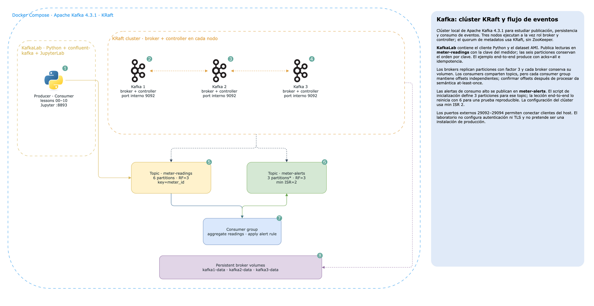

# Kafka Streaming Architecture

Laboratorio autocontenido para estudiar Apache Kafka: KRaft, brokers y quorum de metadatos, particiones, replicación,
productores confiables, consumer groups, offsets, transacciones, retención/compactación, rendimiento y resiliencia.
Incluye una tubería reproducible de lecturas AMI para seguir eventos desde el productor hasta consumidores y alertas.

El mismo dataset sintético se utiliza en los repositorios especializados de Hadoop y Spark. Kafka aquí se estudia como
plataforma de eventos; no requiere esos otros clústeres.

## Arquitectura



Diagrama editable: [`docs/architecture.drawio`](docs/architecture.drawio).

## Arquitectura

| Servicio | Responsabilidad | Acceso |
| --- | --- | --- |
| `kafka1`–`kafka3` | Brokers KRaft combinados broker/controller, replicación RF=3 | `localhost:29092`–`:29094` |
| `kafka-lab` | Python, `confluent-kafka`, dataset y JupyterLab | `http://localhost:8893` |

El clúster usa volúmenes Docker persistentes por broker. Es para aprendizaje local, no para producción: listeners sin TLS,
sin autenticación, quorum pequeño y almacenamiento local.

## Requisitos y arranque

Se requiere Docker Desktop con Compose y aproximadamente 4 GB de memoria disponible. Puertos: `29092`–`29094` y `8893`.

```bash
cd .docker
docker compose up -d --build
docker exec KafkaLab python lessons/00_seed.py
```

Abre JupyterLab en `http://localhost:8893`, o ejecuta las lecciones dentro del contenedor:

```bash
docker exec KafkaLab python lessons/01_kraft_cluster.py
docker exec KafkaLab python lessons/02_partitions_replication.py
# continúa en orden hasta lessons/10_end_to_end.py
```

Varias lecciones reinician sus topics de laboratorio para que los resultados sean reproducibles. No borres los
volúmenes del clúster para repetirlas; el reset de topics no borra los datos de otros topics.

## Lecciones

| # | Tema | Qué observar |
| --- | --- | --- |
| 00 | Dataset común | Semilla de medidores y mensajes reproducibles |
| 01 | KRaft | Brokers, controller quorum y metadata |
| 02 | Particiones y réplicas | Asignación, leader, ISR, claves y orden |
| 03 | Productor confiable | `acks=all`, idempotencia, compresión y callbacks |
| 04 | Consumer groups | Asignación y paralelismo limitado por particiones |
| 05 | Offsets y lag | Watermarks, commit y semántica at-least-once |
| 06 | Transacciones | `read_committed` y atomicidad dentro de Kafka |
| 07 | Retención y compactación | Event log frente a estado/changelog por key |
| 08 | Rendimiento | Batching y compresión medidos localmente |
| 09 | Resiliencia | RF, ISR y comportamiento esperado ante fallo |
| 10 | Flujo integral | Lecturas, agregación y publicación de alertas |

## Notebook

`notebooks/sandbox.ipynb` contiene una ruta compacta por el clúster, una comprobación de topics y una prueba de productor/
consumidor. El notebook se ejecuta en `KafkaLab`; sus celdas llaman las mismas utilidades y no requieren instalar nada
en el host.

## Estructura

```text
.docker/       Dockerfile, Compose y configuración del clúster
data/          archivos generados (ignorado por Git)
docs/          diagrama editable draw.io
lessons/       lecciones 00–10 ejecutables
notebooks/     sandbox
scripts/       utilidades de inicialización
src/lab/       dataset, clientes, helpers y formato de salida
```

Para detener contenedores preservando los datos: `docker compose stop`. Para volver a iniciarlos: `docker compose start`.
No uses `docker compose down -v` salvo que quieras borrar deliberadamente los datos de todos los brokers.
